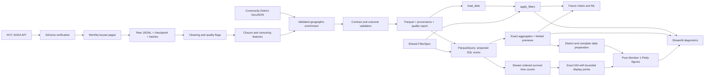

# Shared data pipeline

Phase 2A adds three Member 1 visualizations to the Phase 1.5 query architecture.
Six further charts and model training remain pending. The target runtime is Python 3.12.



## Rerunning the pipeline

Run from the repository root after activating the environment. All commands are
portable Python entry points. Explicit CLI paths are resolved by the shell's
working directory; default data paths and loader-relative paths are anchored to
the repository's data directory, not the current working directory.

```text
python -m pipeline --help
python -m pipeline ingest --help
python -m pipeline ingest --mode smoke --per-month 200 --page-size 100
python -m pipeline geography
python -m pipeline build --run-dir data/raw/smoke --output data/demo/requests.parquet --geography data/geographic/community_districts.geojson
python -m pipeline quality --input data/demo/requests.parquet
python -m streamlit run app.py
```

This smoke recipe selects the earliest 200 creation timestamps per month (lexical ID tie-break), up to 2,400
records. It exercises continuation pages and includes all months; it is not
random or proportional to monthly volume. Do not report its counts or rates as
citywide estimates. The demo can be loaded offline and its provenance says
`mode=smoke`. Synthetic test fixtures are completely separate.

Full extraction is an explicit, potentially long-running operation:

```text
python -m pipeline ingest --mode full --page-size 5000
python -m pipeline build --run-dir data/raw/full --output data/processed/requests.parquet --geography data/geographic/community_districts.geojson
python -m pipeline quality --input data/processed/requests.parquet
```

It retrieves requests created in `[2025-01-01, 2026-01-01)` with one of the five
canonical source borough labels. It retains closures after 2025, provided they
precede extraction cutoff. Requests whose source borough is missing or outside
that scope are not retrieved; no count of those excluded source records is
claimed. Full extraction has not been performed for this delivery.

## Ingestion, memory, and recovery

`SocrataClient` uses requests and urllib3's retry machinery: up to five retries,
exponential backoff (factor 1), Retry-After, retryable 429/500/502/503/504, 15-second
connect and 120-second read timeouts per attempt. Other HTTP errors fail clearly.
Retries can make a single page take several minutes. Successful pages log counts.
No secrets are needed; `.env.example` documents optional environment variables.
The application never starts ingestion automatically.

Each run saves original API row dictionaries in UTF-8 JSONL pages. A page is
renamed atomically before the checkpoint records its hash, row count, retrieval
time, last creation/key cursor, and month. Rerunning with the **same arguments** verifies committed
pages, then resumes after the last creation/key cursor. An uncommitted orphan page is overwritten
at the same sequence number. Do not run two writers against the same run directory.
Changing mode, page size, or sample quota requires a new `--run-dir`. To refresh
source data, choose a new run directory; completed runs are intentionally immutable.

Memory scales with page size. The global ID audit uses temporary SQLite, not an
unbounded Python set. Processing reads one raw page at a time and appends fixed
Arrow-schema row groups to Zstandard-compressed Parquet. SQLite is explicitly
closed before deleting its temporary directory for Windows compatibility. A build
failure leaves an existing output untouched; rerun the build to restart processing.
The Parquet file is replaced atomically. The quality JSON is written afterward;
its checksum detects an old sidecar after a crash between those two writes.

The page manifest records all query parameters needed to reconstruct selection,
plus the schema snapshot and missing auxiliary fields. Raw checksums catch local
corruption. Full mode records a start count; end counts and uniqueness are measured
from downloaded pages. Live updates can invalidate snapshot completeness despite
stable ordering. See [source verification](SOURCES.md).

## Cleaning and outcomes

Only missing IDs and duplicate IDs are excluded from cleaned output; first
committed occurrence wins. Exclusion counts are reported. Normally ingestion
rejects such a run before completion; the build is also defensive for imported
raw artifacts. All other problematic records remain, with explicit flags. Raw
source values are in JSONL, with convenient date/borough/coordinate audit columns
in Parquet. Blank strings become missing; identifiers remain strings.

Source floating times are interpreted in America/New_York, with DST fold/gap
uncertainty becoming NaT. UTC-aware subtraction computes elapsed hours across
23/25-hour days correctly. Calendar features use local time. Invalid coordinates
become null as a pair; missing locations do not exclude a record.

A closure observation requires status `Closed` (case-insensitive), valid created
and closed timestamps, nonnegative elapsed duration, and timestamps no later than
the explicit UTC extraction-start cutoff. Non-closed records with no source closure
date are censored when creation is valid and not after cutoff. Missing status,
malformed closure dates, and conflicting status/date evidence produce unknown
outcomes. Source status is retained; `is_closed` is only its nullable interpretation,
not a substitute for `closure_event`.

`observed_hours` is valid closure duration for events, and cutoff minus creation
for censored rows. The extraction cutoff is one conservative instant shared by
all pages, not the end of each page download. Values reflecting updates after
that cutoff may become unknown. Current snapshot statuses do not reconstruct a
historical status timeline or reopenings.

Long closure means **strictly greater than 168 elapsed hours**. Completed events
at or below 168 are negative. Open observations older than 168 are positive; open
observations at or below 168 remain unknown. No open request gets zero closure
hours. Durations above 8,760 hours are flagged but preserved. See the exact bucket
boundaries and every field in [the dictionary](DATA_DICTIONARY.md).

## Shared contract and consumers

Schema version `1.0.0` is defined centrally in `pipeline.contract.SCHEMA`. It has
52 columns, stable pandas nullable types, and timezone-aware dates. Parquet embeds
source, cutoff, mode, sampling, schema version, and manifest/geography hashes.
`load_data()` validates schema and outcomes and attaches provenance to
`df.attrs['urbanpulse']`. It is local-only and defaults explicitly to `dataset='demo'`.
Selecting `full` never falls back to a sample. The convenience loader still holds
the selected artifact in memory. Full-mode Streamlit instead uses ParquetQuery
for footer validation, option lists, exact summaries, and a 200-row projection.
Demo and smoke modes keep the existing DataFrame workflow.

`apply_filters` returns an independent DataFrame with the same dtypes and attrs;
all active filters are ANDed. Within a category, values are ORed. `None`/`'All'`
means unrestricted; an empty list means no matches. Date endpoints are inclusive
New York calendar dates; timezone-aware endpoints are converted to New York first.
Null dates survive only when no date filter is set. Options exclude null values.
Individual charts must consume the filtered frame, not recreate global filtering.

Breaking changes to names, types, units, null semantics, or outcome definitions
require a major schema version, migration notes, a regenerated dataset, tests,
and review by all three students. Additive changes require a minor version and
updated docs/tests. Even minor-version files require rebuilding or an explicit
loader compatibility change: the current loader accepts exactly 1.0.0. Bug fixes
without contract changes use a patch version and retain provenance.


## Offline preparation versus interactive queries

Ingestion, preprocessing, full uniqueness/outcome validation, and Parquet building
remain **offline** commands. No interactive request downloads or rebuilds data.
Before serving a new snapshot, run the quality command. `inspect_data()` factors
out shared path/footer/schema/provenance checks for both loaders; query startup
intentionally does not repeat an expensive whole-dataset quality scan.

`ParquetQuery` opens a short-lived embedded DuckDB connection for each operation,
scans the local Parquet file with column projection and supported filter pushdown,
and returns a small DataFrame or scalar. All caller values are parameters; SQL
identifiers and metric expressions come from allowlists. Shared `FilterSpec`
normalization drives both SQL and Pandas predicates. Inclusive filtering uses the
existing New York `created_day` strings, preserving DST and NULL-date semantics.
See [TEAM_GUIDE.md](TEAM_GUIDE.md) for signatures and tested aggregate examples.

Queries default to two threads and a 512 MB DuckDB buffer-manager limit. A private
temporary directory permits supported disk spilling and is removed after closing
the connection. These are per-query settings, not a process-wide RAM guarantee.
Returned previews are capped at 10,000 rows; aggregate results above 100,000 groups
raise rather than truncate. Exact statistics are never silently sampled. The app
requests only 200 preview rows and caches bounded results, not the full dataset.

Phase 1.5 also validates resumed checkpoint audit counts and saved cursors against
committed pages. It preserves existing scope, immutable raw records, timestamps,
52-column schema, and historical outcome definitions. See [PERFORMANCE.md](PERFORMANCE.md)
for disk sizing, row-group trade-offs, readiness review, and measured limits.

Member 1 aggregate contracts, streaming computation and display bounds are specified
in [CHART_METHODS.md](CHART_METHODS.md). No stored contract columns changed.
